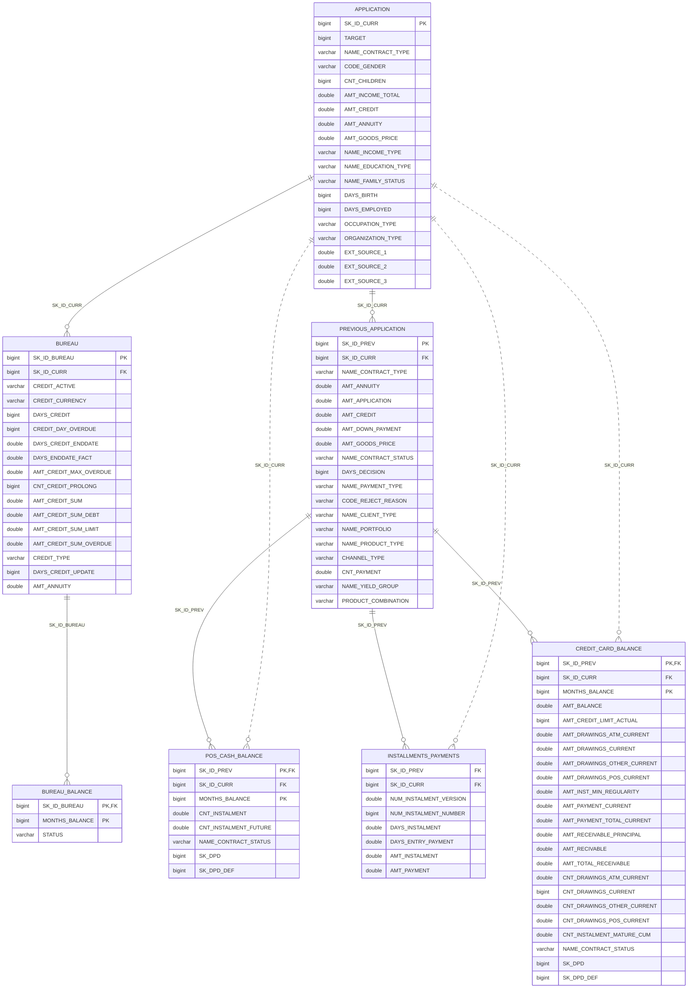

# Credit Scoring - Home Credit Default Risk

Previsão de inadimplência de crédito com base no histórico do cliente, usando o dataset [Home Credit Default Risk](https://www.kaggle.com/c/home-credit-default-risk/data) (Kaggle).

## Modelo de dados

Colunas e tipos extraídos de `data/silver`; em `APPLICATION` e `PREVIOUS_APPLICATION` aparecem apenas chaves e colunas principais. Linha pontilhada = relação direta via `SK_ID_CURR`.